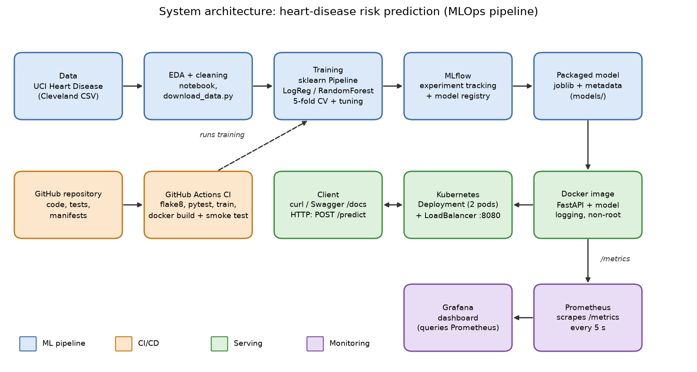

# Heart Disease Risk Prediction - MLOps Assignment 01


**Course:** Machine Learning Operations (MLOps), AIMLCZG523 - BITS Pilani (WILP), Assignment 01
**Author:** Dinesh Kumar Yadav (ID 2025CT05018)
**Repository:** https://github.com/Dinesh-Bits-2026/heart-disease-mlops
**Walkthrough video:** https://youtu.be/D74Bc9mUGh4
**Report:** `report.docx` (repository root)

---

## 1. Overview

This project builds a classifier that predicts the risk of heart disease from patient health data and delivers it as a reproducible, tested, containerised and monitored API, following MLOps practice.

- **Data:** UCI Heart Disease dataset, Cleveland processed file (303 patients, 13 features plus a binary target: 0 = no disease, 1 = disease).
- **Models:** Logistic Regression and Random Forest, tuned with grid search and 5-fold stratified cross-validation. Logistic Regression is the final model.
- **MLOps stages covered:** data download and EDA, feature pipeline, experiment tracking (MLflow), packaging, unit tests and CI/CD (GitHub Actions), Docker, Kubernetes deployment, monitoring (Prometheus and Grafana).

## 2. Architecture



Data flows through the ML pipeline into a packaged model (`models/`). The model is baked into a Docker image with a FastAPI service, deployed on Kubernetes and exposed through a LoadBalancer service. GitHub Actions lints, tests, trains and builds the image on every push. The API exposes Prometheus metrics, which Grafana visualises.

### Project structure

```
heart-disease-mlops/
├── src/                  # download_data.py, features.py, train.py, predict.py
├── api/                  # FastAPI service (app.py) and sample_request.json
├── tests/                # pytest unit tests (data, features, model, API)
├── notebooks/            # 01_eda.ipynb
├── data/                 # heart_raw.csv, heart_clean.csv
├── models/               # final_model.joblib, model_metadata.json
├── k8s/                  # deployment.yaml, service.yaml
├── monitoring/           # Prometheus config and Grafana dashboard provisioning
├── scripts/              # traffic generator, drift check
├── screenshots/          # evidence used in the report
├── .github/workflows/    # ci.yml (GitHub Actions)
├── Dockerfile            # serving image
├── docker-compose.yml    # API + Prometheus + Grafana
├── requirements.txt      # full project dependencies (pinned)
├── requirements-api.txt  # serving-image dependencies only (pinned)
└── requirements-dev.txt  # test, lint and tooling dependencies
```

## 3. Setup / Installation

**Requirements:** Python 3.11, Git, Docker Desktop (with Kubernetes enabled for Section 8). Commands below are for Windows PowerShell; on Linux or macOS use `python3.11 -m venv .venv` and `source .venv/bin/activate`.

```powershell
git clone https://github.com/Dinesh-Bits-2026/heart-disease-mlops.git
cd heart-disease-mlops

py -3.11 -m venv .venv
.\.venv\Scripts\Activate.ps1
pip install -r requirements.txt -r requirements-dev.txt
```

Run the whole flow from a clean setup:

```powershell
python src/download_data.py          # download and clean the dataset
python -m src.train                  # train, track with MLflow, save the model
python -m src.predict                # sample prediction from the saved model
python -m pytest -v                  # unit tests
flake8 src api tests                 # lint
```

## 4. Data and EDA

- **Download:** `python src/download_data.py` fetches the Cleveland processed file from the UCI repository, names the columns, treats `?` as missing and writes `data/heart_raw.csv` and `data/heart_clean.csv`. Source: Heart Disease [Dataset], UCI Machine Learning Repository, https://archive.ics.uci.edu/dataset/45/heart-disease (CC BY 4.0).
- **Cleaning:** the target is converted to binary. Missing values occur only in `ca` (4 rows) and `thal` (2 rows) and are filled with the column median (0 for `ca`, 3 for `thal`), so all 303 records are kept.
- **EDA:** `notebooks/01_eda.ipynb` contains the class balance, numeric histograms and boxplots, correlation heatmap, categorical-versus-target plots and two further plots of my own. Figures are saved in `screenshots/eda/`.
- **Key findings:** the classes are balanced (164 without disease, 139 with disease). `thal`, `ca`, `exang`, `oldpeak` and `cp` correlate positively with the target and `thalach` negatively; `fbs` and `chol` carry almost no linear signal. `oldpeak` is strongly right-skewed.

## 5. Modelling and Experiment Tracking

All preprocessing is part of one scikit-learn pipeline: numeric features are median-imputed and standardised, category-coded features (`cp`, `restecg`, `slope`, `thal`, `ca`) are imputed and one-hot encoded, and binary features are passed through. The same pipeline object is used for training, saving and serving.

| Model | CV accuracy | CV recall | CV ROC-AUC | Test accuracy | Test recall | Test ROC-AUC |
|---|---|---|---|---|---|---|
| Logistic Regression (final) | 0.847 | 0.783 | 0.904 | 0.885 | 0.929 | 0.968 |
| Random Forest | 0.818 | 0.774 | 0.900 | 0.902 | 0.929 | 0.949 |

Logistic Regression was chosen because the two models are effectively tied in cross-validation and the simpler model is faster and easier to explain. The hold-out set (about 61 patients) is too small to overturn the cross-validation result. Training uses a fixed seed (42) and produced identical results across repeated runs.

**MLflow:** every run logs parameters, metrics, the ROC curve and confusion matrix, and the fitted pipeline with signature and input example. Each grid-search setting is a nested run, and the final model is registered.

```powershell
mlflow ui --backend-store-uri sqlite:///mlflow.db
```

Open http://127.0.0.1:5000.

**Packaging and reproducibility:** the final pipeline is saved as `models/final_model.joblib` together with `models/model_metadata.json` (run id, hyper-parameters, features, metrics and library versions). Dependencies are pinned in `requirements.txt` and `requirements-api.txt`.

## 6. Testing and CI/CD

- **Tests:** 29 pytest tests cover data cleaning, the preprocessing pipeline, training helpers, the prediction function and the API (valid requests, missing fields, out-of-range values, wrong types, metrics).
- **CI/CD:** `.github/workflows/ci.yml` runs on every push and pull request: install dependencies, flake8, pytest (JUnit report uploaded), train the model, build the Docker image and smoke-test the running container (`/health` and `/predict`). The trained model and MLflow data are uploaded as artifacts. The pipeline fails on lint, test or build errors and prints clear logs.

```powershell
python -m pytest -v
flake8 src api tests
```

## 7. Docker and API

The model is served by FastAPI. Inputs are validated with allowed ranges (invalid requests return HTTP 422). The image uses `python:3.11-slim`, contains only the serving dependencies, runs as a non-root user and has a health check. Request logs record method, path, status and latency, and the prediction outcome, but never patient health data.

```powershell
docker build -t heart-disease-api:v1 .
docker run --rm -p 8000:8000 heart-disease-api:v1
```

| Endpoint | Description |
|---|---|
| `POST /predict` | JSON patient record in; `prediction`, `label`, `confidence` and `risk_probability` out |
| `GET /health` | Readiness and liveness; confirms the model is loaded |
| `GET /metrics` | Prometheus metrics |
| `GET /model-info` | Metadata of the packaged model |
| `GET /docs` | Interactive API documentation (Swagger UI) |

Test it (in a second terminal; note `curl.exe`, because plain `curl` in PowerShell is a different command):

```powershell
curl.exe http://localhost:8000/health
curl.exe -X POST http://localhost:8000/predict -H "Content-Type: application/json" -d "@api/sample_request.json"
```

Sample request (`api/sample_request.json`):

```json
{
  "age": 54, "sex": 1, "cp": 3, "trestbps": 130, "chol": 246, "fbs": 0,
  "restecg": 0, "thalach": 150, "exang": 0, "oldpeak": 1.0, "slope": 2,
  "ca": 0, "thal": 3
}
```

`confidence` is the probability of the predicted class; `risk_probability` is the probability of heart disease.

**Access to the deployed API:** the service runs locally (no public URL). Use `http://localhost:8000` for the Docker container or Docker Compose, and `http://localhost:8080` for the Kubernetes service.

## 8. Kubernetes Deployment

The image is deployed to a local Kubernetes cluster (Docker Desktop, with Kubernetes enabled in Settings). The Deployment runs two replicas with readiness and liveness probes on `/health` and resource requests and limits; a Service of type LoadBalancer exposes it on port 8080. The manifests use the locally built image `heart-disease-api:v1`, so build it first (Section 7).

```powershell
kubectl config current-context          # docker-desktop
kubectl apply -f k8s/
kubectl rollout status deployment/heart-disease-api
kubectl get pods,svc,deploy

curl.exe http://localhost:8080/health
curl.exe -X POST http://localhost:8080/predict -H "Content-Type: application/json" -d "@api/sample_request.json"
```

Remove the deployment with `kubectl delete -f k8s/`.

## 9. Monitoring and Logging

Docker Compose runs the API together with Prometheus and Grafana. Prometheus scrapes the API's `/metrics` every 5 seconds, and Grafana loads a provisioned dashboard. A single API container is monitored so that counters stay consistent (with several pods behind one service, each scrape would hit a different pod).

```powershell
docker compose pull prometheus grafana     # the API image is built locally
docker compose up -d
python scripts/generate_traffic.py --n 200           # normal traffic (a few invalid requests are included on purpose)
python scripts/generate_traffic.py --n 200 --drift   # shifted patient population
python scripts/drift_check.py                        # compare normal vs shifted predictions
docker compose logs api                              # request logs
```

| Page | URL | Notes |
|---|---|---|
| Grafana dashboard | http://localhost:3000 | login `admin` / `admin` |
| Prometheus targets | http://localhost:9090/targets | API target should be UP |
| API | http://localhost:8000/docs | |

Metrics exposed: `http_requests_total`, `http_request_duration_seconds`, `predictions_total` (by outcome) and `prediction_confidence`. The drift batch is a simple illustration of how a change in the incoming data shows up in the dashboard; it is not full drift detection. Stop everything with `docker compose down`.

## 10. Repository Link and Video

- **Code repository:** https://github.com/Dinesh-Bits-2026/heart-disease-mlops
- **Walkthrough video:** https://youtu.be/D74Bc9mUGh4
- **Final report:** `report.docx`

## Limitations and next steps

The dataset is small (about 300 patients from one study), so metrics are noisy; the model is a learning exercise and not a medical device. The decision threshold is fixed at 0.5. Kubernetes runs on a local single-node cluster using the local image store, and monitoring covers service health and prediction behaviour only. Next steps: a container registry with a managed cluster (GKE, EKS or AKS), threshold tuning for recall, feature-level drift detection with alerts, and automated retraining through the CI pipeline.

## Troubleshooting

- **Docker build times out downloading packages:** re-run the build; the `Dockerfile` caches downloaded packages between attempts.
- **Pods show `ImagePullBackOff`:** the cluster cannot see the local image; build `heart-disease-api:v1` on the same machine and use Docker Desktop's Kubernetes (or run `minikube image load heart-disease-api:v1` on Minikube).
- **Port already in use:** stop other containers using 8000, 9090 or 3000, or change the port mapping in `docker-compose.yml`; the Kubernetes service uses 8080.
